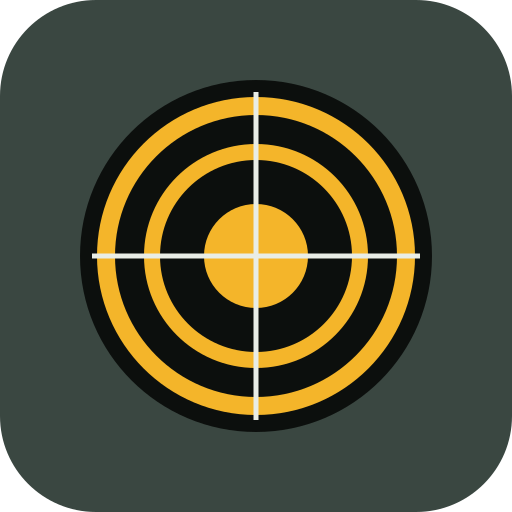
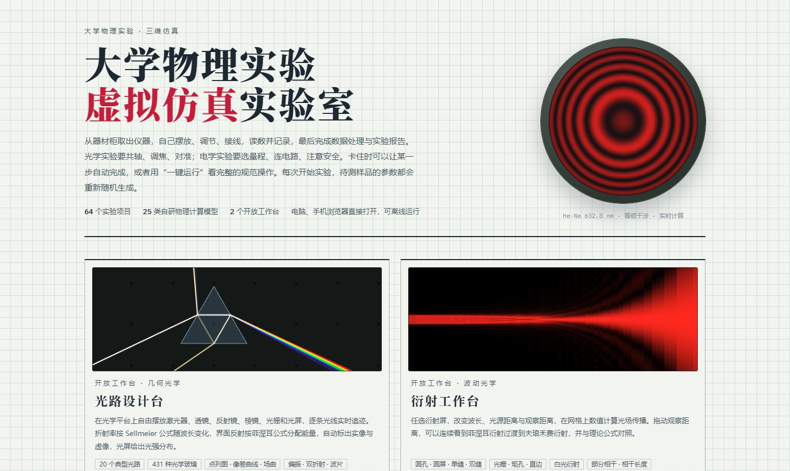
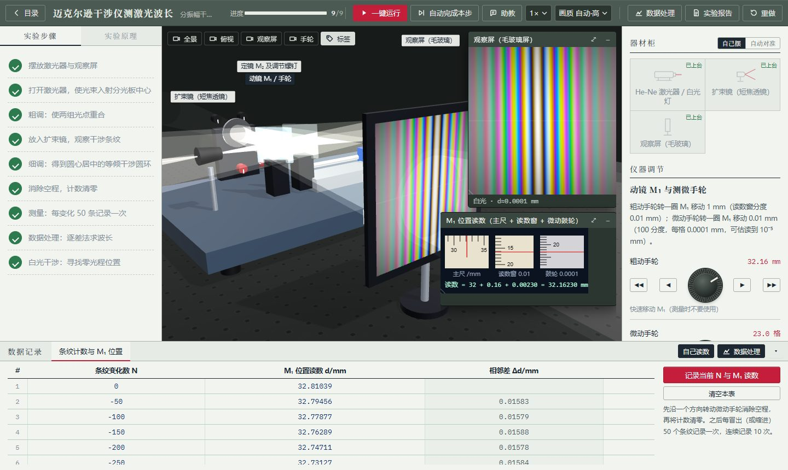
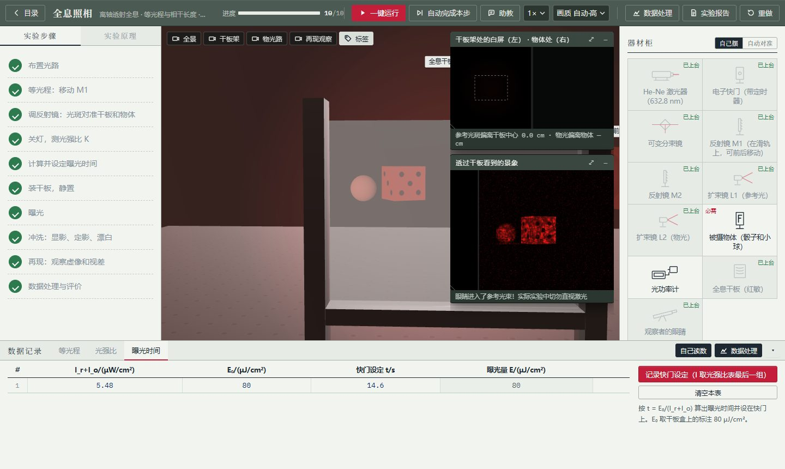

<div align="center">



# 大学物理实验虚拟仿真

**在浏览器里动手做大学物理实验：自己摆器材、调仪器、读数、记录、处理数据。**

65 个实验 · 力学 / 热学 / 电磁学 / 光学 / 近代物理 · 可完全离线运行 · 个人与教学免费使用

### [▶ 在线体验：打开网页就能做实验](https://kami0410.github.io/physics-virtual-lab/)

<sub>电脑、平板、手机的浏览器都可以，不用安装；打开过一次后断网也能用</sub>

[快速开始](#快速开始) · [实验清单](#实验清单) · [AI 助教](#ai-助教) · [详细文档](#文档) · [许可](#许可)

</div>

[](https://kami0410.github.io/physics-virtual-lab/)

## 这是什么

一套按真实实验室操作流程做的三维仿真实验。跟“看动画”不同，这里的仪器要你自己动手：

- **自己摆放、自己调节**：器材从器材柜里取出来放到实验台上；光学实验要做等高共轴、调焦、对准，电学实验要选量程、连线，接错了会烧表、会有警告。
- **自己读数**：默认开启“自己读数”，记录时表格里的读数要你看着刻度、表盘、游标自己填，程序会核对你读得对不对。
- **仪器带真实误差**：零点误差、回程差、量程误差、环境光、平台振动、温度漂移……每次打开实验，待测样品的参数都随机生成，抄不了别人的数据。
- **完整的数据处理**：逐差法、最小二乘拟合、作图、不确定度，最后能导出实验报告。也可以开“自算模式”，自己算结果再让程序核对。
- **做到一半可以接着做**：进度自动保存在本机浏览器里，刷新、误关页面或退回目录后再进来，器材摆放、接线、旋钮和已记的数据都还在，仪器也还是上次那一台；目录里会标出“继续 · 3/8 步”。
- **卡住了有办法**：每一步都能“自动完成本步”，或者“一键运行”看一遍规范操作；也可以叫 [AI 助教](#ai-助教) 帮你找原因。

<p align="center">
<a href="https://kami0410.github.io/physics-virtual-lab/#/exp/michelson"></a>
<a href="https://kami0410.github.io/physics-virtual-lab/#/exp/holo"></a>
</p>

<p align="center"><sub>左：迈克尔逊干涉仪，白光干涉条纹、测微手轮三级读数、逐条记录的数据表。右：全息照相，拿走物体后透过全息图看到的再现像</sub></p>

## 快速开始

**最快的方式：直接打开 [在线版](https://kami0410.github.io/physics-virtual-lab/)**，什么都不用装。下面是在自己电脑上运行的方法，适合长期使用、离线使用，或者要接入只能经中转访问的 AI 服务（如智谱）。

### 在自己电脑上运行

需要先装 [Node.js](https://nodejs.org/zh-cn)（选 LTS 版，一路“下一步”即可）。然后下载本仓库：点页面上方绿色的 **Code → Download ZIP**，解压到任意文件夹。

| 系统 | 怎么启动 |
|---|---|
| **Windows** | 双击 **`启动实验室.cmd`** |
| **macOS** | 右键 **`启动实验室.command`** → 打开（第一次需要这样绕过系统的安全提示） |
| **Linux** | 终端里运行 `sh 启动实验室.command` |

第一次启动会自动安装依赖（一两分钟），之后浏览器会自动打开实验室页面。**用完关掉那个黑色的命令行窗口就行**。再次双击时如果实验室已经开着，只会重新打开浏览器页面。

想用命令行的话：

```bash
npm install
npm run dev        # 打开 http://127.0.0.1:5173
```

### 离线单文件版（不用装 Node.js）

**[⬇ 下载离线版 physics-virtual-lab.html](https://github.com/kami0410/physics-virtual-lab/releases/latest/download/physics-virtual-lab.html)**（约 5 MB，[所有版本](https://github.com/kami0410/physics-virtual-lab/releases/latest)）

一个文件就是完整的实验室，65 个实验、三维模型、公式字体都在里面。下载后双击，用 Chrome / Edge / Firefox 打开就能用，不需要联网、不需要安装。拷到 U 盘、发到群里都行。

想自己从源码生成：运行 `npm run build:single`，得到 `dist-single/index.html`。

> 安装、启动遇到问题（下载慢、端口被占用、Mac 打不开等），看 [启动与安装](docs/getting-started.md)。

## 实验清单

<details open>
<summary><b>光学（19）</b></summary>

| 实验 | 测量内容 |
|---|---|
| 薄透镜焦距的测定 | 凸透镜焦距 f |
| 自组望远镜和显微镜 | 视角放大率 Γ |
| 杨氏双缝干涉 | 钠光波长 λ、双缝间距 d |
| 双棱镜干涉测钠光波长 | 钠光波长 λ |
| 牛顿环测透镜曲率半径 | 平凸透镜曲率半径 R |
| 劈尖干涉测细丝直径 | 细丝直径 D |
| 迈克尔逊干涉仪测激光波长 | He-Ne 激光波长 λ，白光干涉 |
| 法布里–珀罗干涉仪 | 钠 D 双线波长差 Δλ |
| 分光计调节与光栅衍射 | 光栅常数 d、汞灯谱线波长 |
| 三棱镜折射率与色散 | 顶角 A、折射率 n(λ) |
| 单缝衍射光强分布 | 单缝宽度 a |
| 超声光栅测声速 | 液体中的声速 v |
| 阿贝成像与空间滤波 | 光栅常数 d、不同滤波器下的像 |
| 光的偏振 | 马吕斯定律、消光角 |
| 布儒斯特角与菲涅耳公式 | 布儒斯特角 θ_B、玻璃折射率 n |
| 旋光仪测糖溶液浓度 | 比旋光度、未知溶液浓度 |
| 全息照相 | 光强比 K、曝光时间；冲洗与再现 |
| 光纤的传输特性 | 耦合效率、损耗系数、数值孔径、弯曲损耗 |
| 光敏二极管的光电特性 | 暗电流、光电灵敏度、结电容 |

</details>

<details>
<summary><b>电磁学（19）</b></summary>

| 实验 | 测量内容 |
|---|---|
| 伏安法测电阻 | 电阻阻值、二极管伏安特性 |
| 惠斯通电桥测电阻 | 中值电阻、电桥灵敏度 |
| 双臂电桥测低电阻 | 金属棒电阻与电阻率 |
| 电表的改装与校准 | 表头内阻、分流与分压电阻 |
| 十一线电位差计测电动势 | 干电池电动势与内阻 |
| 示波器的使用 | 峰峰值、频率、李萨如图形 |
| RC、RLC 电路的暂态过程 | 时间常数、振荡周期、临界电阻 |
| RC、RLC 串联电路的稳态特性 | 相频特性、谐振频率、品质因数 |
| 示波器观测动态磁滞回线 | 磁化曲线、Bₘ、Bᵣ、H_c |
| 霍尔效应 | 霍尔系数、载流子类型与浓度、迁移率 |
| 圆线圈与亥姆霍兹线圈的磁场 | 轴线磁场分布 |
| 模拟法描绘静电场 | 同轴电极间的等势线 |
| 地磁场的测量 | 水平分量、总强度、磁倾角 |
| 电子束的电偏转与磁聚焦 | 偏转灵敏度、电子荷质比 |
| 铁磁材料居里温度的测定 | 居里温度 T_C |
| 太阳能电池的基本特性 | 伏安特性、填充因子、转换效率 |
| 磁耦合谐振式无线输电 | 自感、耦合系数、频率分裂、传输效率 |
| 电磁混合磁悬浮 | 零功率悬浮、负刚度与电流刚度 |
| 传感器与数据采集 | 称重传感器标定、混叠、ADC 量化噪声 |

</details>

<details>
<summary><b>力学（14）</b></summary>

| 实验 | 测量内容 |
|---|---|
| 长度测量与固体密度 | 游标卡尺、千分尺、天平；密度及不确定度 |
| 单摆测重力加速度 | 重力加速度 g，摆角对周期的影响 |
| 三线摆测转动惯量 | 圆盘、圆环、圆柱的转动惯量 |
| 拉伸法测金属丝的杨氏模量 | 钢丝杨氏模量（光杠杆） |
| 落球法测液体的黏滞系数 | 蓖麻油黏滞系数 |
| 拉脱法测液体表面张力系数 | 水的表面张力系数 σ |
| 气垫导轨上的碰撞 | 碰撞前后的动量与动能 |
| 弹簧振子的研究 | 劲度系数 k、有效质量 |
| 用波尔共振仪研究受迫振动 | 阻尼系数、幅频与相频特性 |
| 弦线上的驻波 | 波长、波速与线密度 |
| 声速的测定 | 空气中的声速 |
| 克拉尼图形与方板的振动模式 | 共振频率、杨氏模量 |
| 探究乐音：音调、音色与拍 | 音阶频率、谐波结构、拍频（可播放声音） |
| 蛇摆的设计与制作 | 摆长设计与周期 |

</details>

<details>
<summary><b>热学（6）</b></summary>

| 实验 | 测量内容 |
|---|---|
| 空气比热容比的测定 | 比热容比 γ |
| 金属线膨胀系数的测定 | 线膨胀系数 α |
| 冷却法测金属的比热容 | 铁、铝的比热容 |
| 稳态平板法测不良导体的导热系数 | 橡胶的导热系数 |
| 准稳态法测导热系数和比热容 | 有机玻璃的导热系数与比热容 |
| PN 结与热敏电阻的温度特性 | 玻尔兹曼常数、禁带宽度、热敏电阻 B 值 |

</details>

<details>
<summary><b>近代物理（7）</b></summary>

| 实验 | 测量内容 |
|---|---|
| 光电效应测普朗克常数 | 普朗克常数 h、逸出功 |
| 弗兰克–赫兹实验 | 氩原子第一激发电位 |
| 密立根油滴实验 | 元电荷 e |
| 电子荷质比的测定 | e/m |
| 塞曼效应 | 由汞 546.1 nm 谱线分裂求 e/m |
| 金属电子逸出功的测定 | 钨的逸出功（理查森直线法） |
| G-M 计数器与放射性统计 | 坪曲线、计数的泊松分布、双源法测死时间、β 射线在铝中的吸收 |

</details>

另有两个不限定步骤的**开放工作台**：

- **光路设计台**：在光学平台上自由摆放激光器、透镜、棱镜、光栅、偏振片等，实时追迹光线（含菲涅耳反射、全反射、色散、偏振），带点列图、像差曲线等像质分析。
- **衍射工作台**：任选衍射屏，改变波长和距离，数值计算光场传播，看菲涅耳衍射怎样过渡到夫琅禾费衍射。

做完实验后，部分光学实验可以把你的光路一键导出到工作台里继续研究。

## AI 助教

点实验页顶栏的 **助教** 按钮打开。分两层：

1. **离线检查（不联网、不用配置）**：列出这一步现在哪里不对，比如“光斑偏离屏中心 1.8 cm”“表格里还有两个读数没填”，能直接修正的会给一个按钮；还可以“让助教接手本步”。某一步卡了很久时，助教按钮会提示你。
2. **接入大模型（可选）**：在助教面板右上角 **设置** 里选一个服务、填密钥。之后可以直接提问，比如“为什么条纹不清楚？”。助教能看到实验的当前状态和你最近的操作记录，会解释原因，必要时替你把出问题的那个旋钮调好（你能看着它转过去）。

支持 Claude、DeepSeek、通义千问、Kimi、智谱 GLM、硅基流动、OpenRouter、OpenAI、Gemini，以及**本机运行的 Ollama / LM Studio（免费、不联网）**。密钥只存在你自己电脑的浏览器里。

> 每个服务怎么申请密钥、怎么配置，本机模型怎么装，连不上怎么办：看 [AI 助教使用说明](docs/ai-tutor.md)。

## 文档

| 文档 | 内容 |
|---|---|
| [启动与安装](docs/getting-started.md) | 一键启动的细节、离线单文件版、部署到网站、常见问题 |
| [AI 助教使用说明](docs/ai-tutor.md) | 各服务的配置方法、本机模型、中转、隐私、排错 |
| [开发说明](docs/development.md) | 目录结构、实验模块怎么写、测试 |
| [致谢与来源](CREDITS.md) | 用到的开源组件、收录的代码、公式与数据出处 |

## 致谢

本项目的物理模型和界面大部分是自己写的，也站在了许多开源项目的肩膀上，在此致谢：

- **程序里用到的组件**：[three.js](https://github.com/mrdoob/three.js)（三维渲染）、[KaTeX](https://github.com/KaTeX/KaTeX)（公式排版）、[spice-ts](https://github.com/mfiumara/spice-ts)（电路仿真）、[IBM Plex Mono](https://github.com/IBM/plex)（等宽字体）、[Anthropic SDK](https://github.com/anthropics/anthropic-sdk-typescript)（AI 助教接入 Claude）
- **收录并改写的代码**：[Optica Viva](https://github.com/iiogurt/Optica_Viva)（光学玻璃库、透镜精确追迹）、[Magpylib](https://github.com/magpylib/magpylib)（电流环磁场）、[geomagnetism](https://github.com/naturalatlas/geomagnetism)（世界地磁模型）
- **借鉴了思路**：[ray-optics](https://github.com/ricktu288/ray-optics)、[LightPipes](https://github.com/opticspy/lightpipes)、[diffractsim](https://github.com/rafael-fuente/diffractsim)、[woscope](https://github.com/m1el/woscope)、[JAmodel](https://github.com/romanszewczyk/JAmodel) 等
- **数据**：CIE 色匹配函数、[refractiveindex.info](https://refractiveindex.info) 玻璃目录、NOAA / 英国地质调查局的 WMM2025 地磁模型、NIST 热电偶参考表、IAPWS 水的表面张力等

每一项的版本、许可证、用在哪里、改了什么，以及所有公式和数据的文献出处，都列在 [CREDITS.md](CREDITS.md) 里。

## 许可

Copyright © 2026 kami0410。本项目采用 [PolyForm Noncommercial License 1.0.0](LICENSE)，简单说：

| | |
|---|---|
| ✅ 个人学习、研究、业余爱好 | 免费使用 |
| ✅ 学校教学、科研机构、公益组织、政府机构 | 免费使用 |
| ✅ 修改、转发、在此基础上二次开发 | 可以，需附上本许可 |
| ❌ 商业用途（出售、收费课程、商业产品等） | 不允许，如需商用请先联系 |

这是“源码公开、非商业免费”的许可，不属于 OSI 定义的开源许可证。项目中收录的第三方代码（Optica Viva、Magpylib、geomagnetism 等）仍按其原许可证（MIT、BSD-2-Clause、Apache-2.0）授权，见 [CREDITS.md](CREDITS.md) 与 `licenses/` 目录。
